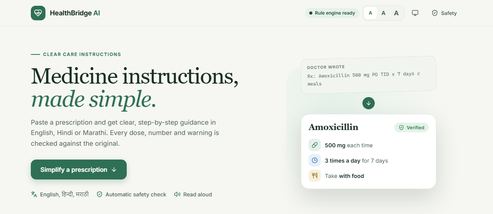
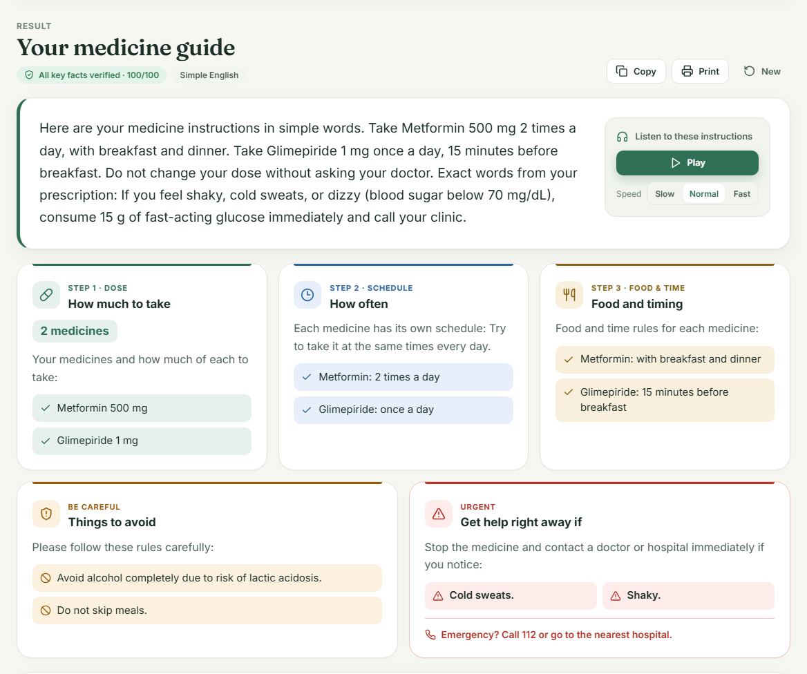
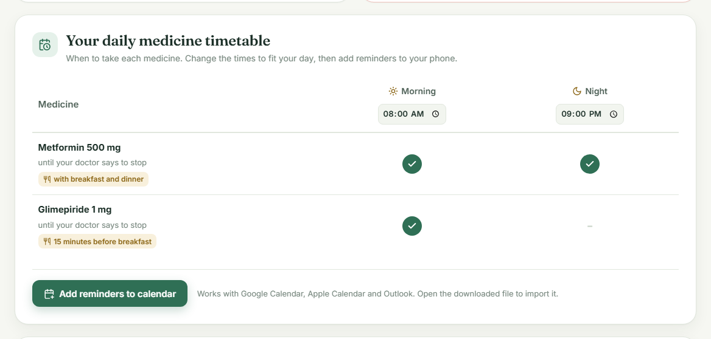
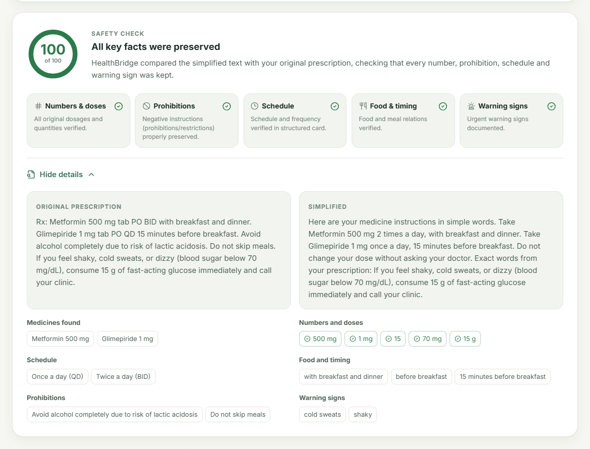
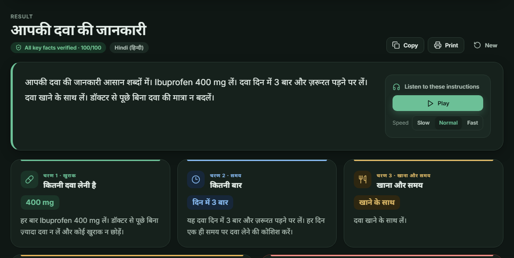

# HealthBridge AI

HealthBridge AI is a web application that converts complex medical prescriptions into clear, easy-to-follow instructions for patients. It supports English, Hindi and Marathi, and automatically verifies that no dosage, number, restriction or warning from the original prescription is lost during simplification.

This project was developed as a Semester V mini project in Artificial Intelligence in Healthcare.



## Overview

Prescriptions are often written in clinical shorthand, for example "Amoxicillin 500 mg PO TID x 7 days". Many patients find this difficult to understand, which can lead to missed or incorrect doses. HealthBridge AI rewrites such instructions in simple language and organises them into dose, schedule, food timing, precautions and warning signs.

Generative AI can simplify text well, but it can also change or omit important details. To address this, every result is checked against the original prescription by a rule-based verification engine, which produces a safety score from 0 to 100.

## Features

- Simplifies prescriptions into structured instruction cards covering dose, schedule, food and timing, precautions and warning signs
- Output in English, Hindi and Marathi
- Safety verification of numbers, prohibitions, schedules, food timing and warning signs, with a 0–100 score
- Side-by-side comparison of the original and simplified text
- Separate schedules for prescriptions with more than one medicine
- Daily medicine timetable with exportable calendar reminders for Google Calendar, Apple Calendar and Outlook
- Audio read-aloud with adjustable speed
- Adjustable text size, light and dark themes, and a mobile-friendly layout
- Daily checklist, copy to clipboard and print-ready handout
- Works without an AI key through a built-in rule-based engine

## Screenshots

**Simplified instructions**



**Medicine timetable**



**Safety verification**



**Hindi output**



## Tech Stack

- **Frontend:** React, Vite, CSS
- **Backend:** Python, FastAPI, Pydantic
- **AI:** Google Gemini, with optional support for Groq and OpenAI
- **Other:** Web Speech API for read-aloud, iCalendar format for reminders, Pytest for testing

## Getting Started

### Prerequisites

- Python 3.10 or later
- Node.js 18 or later
- A Google Gemini API key (optional)

### Quick Start on Windows

```bash
git clone https://github.com/Ifra-Mahate/HealthBridge-AI.git
cd HealthBridge-AI
start.bat
```

The script installs the required packages, builds the frontend and opens the application at http://127.0.0.1:8000.

### Manual Setup

```bash
git clone https://github.com/Ifra-Mahate/HealthBridge-AI.git
cd HealthBridge-AI

# Backend
cd backend
python -m venv venv
venv\Scripts\activate
pip install -r requirements.txt
copy .env.example .env

# Frontend
cd ../frontend
npm install
npm run build

# Run
cd ../backend
python run.py
```

Then open http://127.0.0.1:8000 in your browser.

On macOS or Linux, use `source venv/bin/activate` and `cp .env.example .env` instead.

### Configuration

To enable AI-generated wording, add your API key to `backend/.env`:

```
AI_PROVIDER=gemini
GEMINI_API_KEY=your_api_key_here
GEMINI_MODEL=gemini-3.8-flash
```

A free key can be created at [Google AI Studio](https://aistudio.google.com/apikey). Restart the backend after making changes. If no key is provided, the application uses its rule-based engine.

## Usage

1. Paste a prescription into the input box, or select one of the sample prescriptions.
2. Choose English, Hindi or Marathi.
3. Click **Simplify instructions**.
4. Review the instruction cards, timetable and safety score. Use the available options to listen, print, copy or add reminders to your calendar.

## API

The backend provides a REST API. Interactive documentation is available at http://127.0.0.1:8000/docs while the server is running.

| Method | Endpoint | Description |
| --- | --- | --- |
| GET | `/api/health` | Server and AI configuration status |
| GET | `/api/samples` | Sample prescriptions |
| POST | `/api/extract` | Extracted clinical details |
| POST | `/api/simplify` | Simplified instructions, verification report and timetable |

## Project Structure

```
HealthBridge-AI/
├── backend/
│   ├── app/
│   │   ├── main.py
│   │   ├── config.py
│   │   ├── models/
│   │   ├── data/
│   │   └── services/
│   ├── tests/
│   ├── requirements.txt
│   └── run.py
├── frontend/
│   ├── src/
│   │   ├── components/
│   │   └── utils/
│   ├── index.html
│   └── package.json
├── docs/screenshots/
└── start.bat
```

## Testing

```bash
cd backend
venv\Scripts\python -m pytest
```

The test suite covers clinical detail extraction, safety verification, the API and timetable generation. It also checks that all numbers are preserved for every sample prescription in all three languages.

## Limitations

- Extraction is pattern-based and may not recognise unusual wording.
- Without an AI key, some precautions appear in English within Hindi and Marathi output.
- Read-aloud quality depends on the voices installed on the device.
- The system has not been clinically validated.

## Future Scope

- Reading prescriptions from photos using OCR
- Support for additional Indian languages
- Drug interaction checks
- A mobile application with reminder notifications

## Disclaimer

This project is intended for academic and demonstration purposes only. It does not provide medical advice and is not a substitute for a qualified doctor or pharmacist. All sample prescriptions are fictional.

## Author

**Ifra Mahate**
Semester V Mini Project, Artificial Intelligence in Healthcare
[github.com/Ifra-Mahate](https://github.com/Ifra-Mahate)
