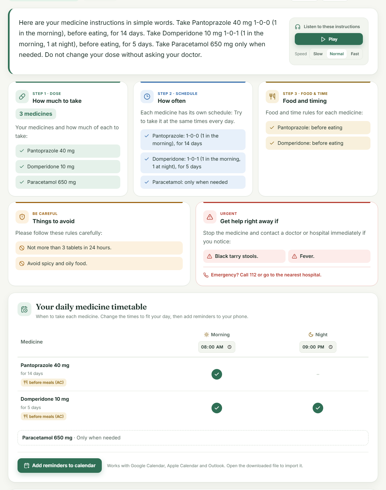
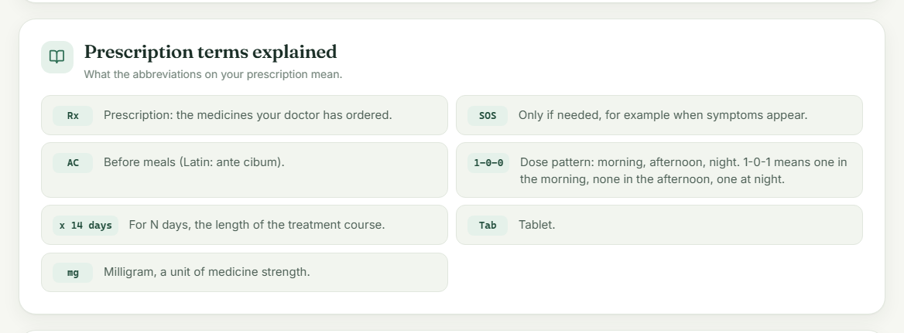

# HealthBridge AI

HealthBridge AI converts medical prescriptions into clear, verified instructions that any patient or caregiver can follow. It supports English, Hindi and Marathi, understands both international and Indian prescription notation, and checks every result against the original prescription so that no dose, restriction or warning is lost or altered.

This project was developed as a Semester V mini project in Artificial Intelligence in Healthcare.


## Overview

Prescriptions are written in clinical shorthand such as "Amoxicillin 500 mg PO TID x 7 days" or, in India, "Tab Pantoprazole 40 mg 1-0-0 AC". Patients of every background misread these instructions. The risk is highest for elderly patients managing several medicines, caregivers giving medicine to someone else, and people reading in a second language. Medication errors caused by misunderstanding are common and preventable.

Large language models can rewrite medical text in plain language, but they can also change a number, drop a warning or invert a prohibition. HealthBridge AI addresses this by combining an LLM with a rule-based clinical extractor and an independent verification engine. The verifier compares the output with the original prescription, scores how faithfully it was preserved, and flags specific problems.

## Features

- Plain-language instructions organised into dose, schedule, food and timing, things to avoid, and warning signs
- Output in English, Hindi and Marathi
- Support for Indian prescription notation, including 1-0-1 dose patterns, OD, BD, TDS, QDS, SOS, AC and PC
- Glossary that explains every abbreviation found on the prescription, in the selected language
- Safety verification with a 0–100 score, covering numbers, dose-to-medicine binding, prohibitions, schedules, food timing and warning signs
- Separate schedules and course lengths for prescriptions with several medicines
- Daily and weekly medicine timetable, with calendar reminders for Google Calendar, Apple Calendar and Outlook
- Audio read-aloud, adjustable text size, light and dark themes, and a mobile-friendly layout
- Daily checklist, copy to clipboard and print-ready handout
- Works without an AI key through the built-in rule-based engine

## Screenshots

**Simplified instructions**


**Indian prescription notation with medicine timetable**



**Prescription terms explained**



**Safety verification**


**Hindi output**


## Methodology

1. **Clinical extraction.** A rule-based extractor identifies medicines and strengths, numbers and units, dosing frequencies, course durations, food and timing rules, prohibitions and warning signs. It normalises Latin abbreviations and Indian notation.
2. **Simplification.** The prescription is rewritten by an LLM (Google Gemini by default) under a strict prompt that forbids changing numbers or removing warnings. Without an API key, or if the AI call fails, a deterministic rule-based writer produces the instructions in all three languages.
3. **Verification.** The output is checked against the extracted facts. Every original number must appear. Each dose must stay attached to its unit and its medicine. Each prohibition must still be stated as a prohibition. The schedule, food timing and warning signs must be present.
4. **Timetable and glossary.** These are built directly from the original prescription, so they stay correct whichever model wrote the explanation.

## Evaluation

The system was evaluated on 45 fictional, hand-annotated prescriptions. 30 were used during development, and 15 were held out and written after development was frozen. The full report, including every error, is in [docs/EVALUATION.md](docs/EVALUATION.md). It can be reproduced with `python -m evaluation.evaluate` from the `backend` folder.

**Extraction on the held-out test set**

| Entity | Precision | Recall | F1 |
| --- | --- | --- | --- |
| Medicine name and strength | 92.9% | 81.2% | 86.7% |
| Dosing frequency | 100.0% | 78.9% | 88.2% |
| Course duration | 100.0% | 83.3% | 90.9% |
| Warning signs | 100.0% | 57.1% | 72.7% |
| Prohibition present | 100.0% | 85.7% | 92.3% |

**Verifier sensitivity.** Known errors were inserted into correct outputs to measure how many the verifier catches. The first version of the verifier only checked that numbers and negation words were present somewhere in the output, so it missed subtle but dangerous errors. Version 2 added dose binding and per-prohibition coverage.

| Inserted error | Cases | Verifier v1 | Verifier v2 |
| --- | --- | --- | --- |
| Dose number altered or deleted | 90 | 100.0% | 100.0% |
| All prohibitions or warning signs removed | 44 | 100.0% | 100.0% |
| Two dose numbers swapped | 31 | 0.0% | 93.5% |
| Prohibition inverted ("Do not X" becomes "X") | 23 | 0.0% | 87.0% |
| One of several prohibitions removed | 3 | 0.0% | 100.0% |

Neither version raised more false alarms than the other on unmodified outputs (4.4% for both).

**Live LLM output.** In a small run with Google Gemini, 4 of 5 prescriptions were answered within the 4-minute limit. All 4 were rated VERIFIED by verifier v2, with every number preserved. The fifth timed out and the system fell back to the rule engine. The median response time was about 2 minutes, which shows why the offline fallback matters in practice. This sample is too small to draw firm conclusions about the LLM.

**Readability.** Across all 45 prescriptions, the output contains none of the 70 clinical abbreviations present in the originals.

**Key findings**

- The rule-based extractor is precise but does not generalise well to unseen phrasing. F1 drops from 93–100% on the development set to 73–92% on the held-out set, mainly because of formats such as "t.d.s.", "b.d.", numbers written as words, and brand names without units. This supports using an LLM for the language task and keeping rules for verification.
- Checking only for the presence of numbers and negation words is not enough to catch swapped doses or inverted instructions. Structural checks close most of this gap.
- The timetable is the weakest component on unseen text (46.7% exact accuracy on the held-out set), because it depends entirely on frequency extraction.

## Tech Stack

- **Frontend:** React, Vite, CSS
- **Backend:** Python, FastAPI, Pydantic
- **AI:** Google Gemini, with optional support for Groq and OpenAI
- **Other:** Web Speech API for read-aloud, iCalendar format for reminders, Pytest and GitHub Actions for testing

## Getting Started

### Prerequisites

- Python 3.10 or later
- Node.js 18 or later
- A Google Gemini API key (optional)

### Quick Start on Windows

```bash
git clone https://github.com/Ifra-Mahate/HealthBridge-AI.git
cd HealthBridge-AI
start.bat
```

The script installs the required packages, builds the frontend and opens the application at http://127.0.0.1:8000.

### Manual Setup

```bash
git clone https://github.com/Ifra-Mahate/HealthBridge-AI.git
cd HealthBridge-AI

# Backend
cd backend
python -m venv venv
venv\Scripts\activate
pip install -r requirements.txt
copy .env.example .env

# Frontend
cd ../frontend
npm install
npm run build

# Run
cd ../backend
python run.py
```

Then open http://127.0.0.1:8000 in your browser. On macOS or Linux, use `source venv/bin/activate` and `cp .env.example .env` instead.

### Configuration

To enable AI-generated wording, add your API key to `backend/.env`:

```
AI_PROVIDER=gemini
GEMINI_API_KEY=your_api_key_here
GEMINI_MODEL=gemini-3.8-flash
```

A free key can be created at [Google AI Studio](https://aistudio.google.com/apikey). Restart the backend after making changes. If no key is provided, the application uses its rule-based engine.

## Usage

1. Paste a prescription into the input box, or select one of the sample prescriptions.
2. Choose English, Hindi or Marathi.
3. Click **Simplify instructions**.
4. Review the instruction cards, timetable, glossary and safety score. Use the available options to listen, print, copy or add reminders to your calendar.

## API

Interactive documentation is available at http://127.0.0.1:8000/docs while the server is running.

| Method | Endpoint | Description |
| --- | --- | --- |
| GET | `/api/health` | Server and AI configuration status |
| GET | `/api/samples` | Sample prescriptions |
| POST | `/api/extract` | Extracted clinical details |
| POST | `/api/simplify` | Simplified instructions, verification report, timetable and glossary |

## Project Structure

```
HealthBridge-AI/
├── backend/
│   ├── app/
│   │   ├── services/        # extractor, AI service, rule-based writer, verifier, timetable, glossary
│   │   ├── models/
│   │   ├── data/
│   │   ├── config.py
│   │   └── main.py
│   ├── evaluation/          # annotated datasets and evaluation script
│   ├── tests/
│   └── requirements.txt
├── frontend/
│   └── src/
│       ├── components/
│       └── utils/
├── docs/
│   ├── EVALUATION.md
│   └── screenshots/
└── start.bat
```

## Testing

```bash
cd backend
venv\Scripts\python -m pytest
```

The test suite covers extraction, Indian notation, the verifier, the API, the timetable and the glossary. It includes regression tests for safety issues found during development. For example, a daily maximum such as "not more than 3 tablets in 24 hours" must never be shown as a single dose, and "Do NOT take on an empty stomach" must never be shown as a direction. Tests and the offline evaluation run automatically on every push through GitHub Actions.

## Limitations

- Extraction is pattern-based and misses unfamiliar phrasing, as the held-out evaluation shows.
- Per-prohibition verification is applied to English output only.
- Without an AI key, some precautions appear in English within Hindi and Marathi output.
- The evaluation data is small, fictional and annotated by the author.
- The system has not been clinically validated, and no patient comprehension study was performed.

## Future Scope

- Learning-based extraction, for example a fine-tuned clinical named-entity model, to improve recall on unseen phrasing
- Distinguishing indications ("for fever") from warning signs
- Per-prohibition verification for Hindi and Marathi using translation or multilingual embeddings
- Reading prescriptions from photos using OCR
- A larger, clinician-annotated dataset and a user study measuring comprehension

## Disclaimer

This project is intended for academic and demonstration purposes only. It does not provide medical advice and is not a substitute for a qualified doctor or pharmacist. All sample prescriptions are fictional.

## Author

**Ifra Mahate**
Semester V Mini Project, Artificial Intelligence in Healthcare
[github.com/Ifra-Mahate](https://github.com/Ifra-Mahate)
