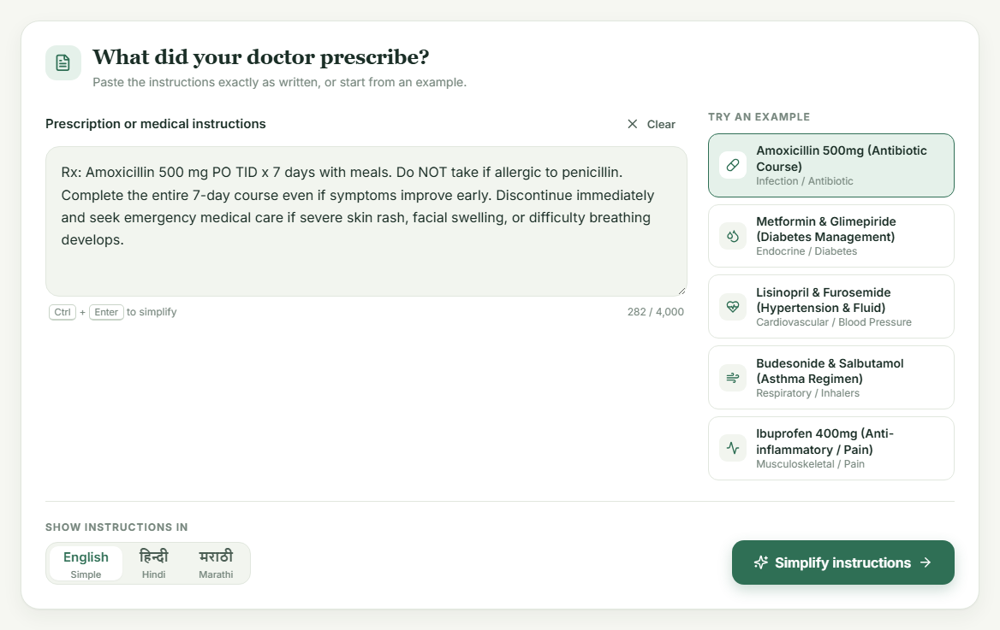
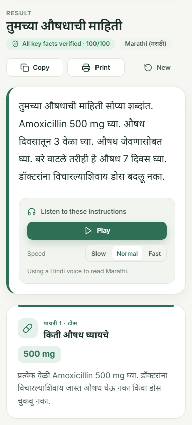
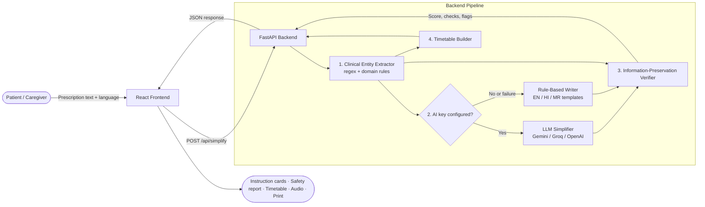

<div align="center">

# HealthBridge AI

### Simplifying Medical Prescriptions for Low-Literacy Patients with AI and Rule-Based Safety Verification


**Semester V Mini Project · Artificial Intelligence in Healthcare**

</div>

---

## Table of Contents

1. [Abstract](#abstract)
2. [Problem Statement](#problem-statement)
3. [Objectives](#objectives)
4. [Key Features](#key-features)
5. [Screenshots](#screenshots)
6. [System Architecture](#system-architecture)
7. [Methodology](#methodology)
8. [Technology Stack](#technology-stack)
9. [Project Structure](#project-structure)
10. [Installation and Setup](#installation-and-setup)
11. [API Reference](#api-reference)
12. [Testing](#testing)
13. [Limitations](#limitations)
14. [Future Scope](#future-scope)
15. [Disclaimer](#disclaimer)
16. [Author](#author)

---

## Abstract

Medical prescriptions are usually written in clinical shorthand such as *"Amoxicillin 500 mg PO TID x 7 days"*. Many patients cannot reliably interpret this, especially those with limited literacy or limited English. Misunderstanding a dose, its frequency or a contraindication can lead to medication errors and poor treatment outcomes.

**HealthBridge AI** is a web application that converts complex prescription text into clear, structured, patient-friendly instructions in **Simple English, Hindi and Marathi**. It combines a **Large Language Model** (Google Gemini, with Groq and OpenAI as alternatives) for natural-language simplification with a **rule-based clinical extraction and verification engine**. The engine independently checks that every dosage, number, prohibition, schedule and warning sign from the original prescription is preserved in the simplified output, and reports this as a 0–100 safety score.

The system also produces a daily medicine timetable with calendar reminders, reads instructions aloud, and runs fully offline through a deterministic rule-based fallback when no AI key is configured.

---

## Problem Statement

- Prescriptions use Latin abbreviations (`BID`, `TID`, `PRN`, `PO`) and dense clinical language that patients often misread.
- India's linguistic diversity means English-only instructions exclude a large share of patients.
- Generative AI can simplify text, but it may **hallucinate, round or drop critical details**, which is unacceptable in a medical context.

There is a need for a tool that simplifies medical instructions **and** verifies that the simplification is faithful to the original.

---

## Objectives

1. Convert raw prescription text into simple, structured instructions covering dose, schedule, food timing, precautions and warning signs.
2. Support **English, Hindi and Marathi** output.
3. Automatically **verify information preservation** between the original and simplified text.
4. Improve accessibility for low-literacy users through **audio read-aloud**, large-text modes and a clear visual layout.
5. Help patients follow treatment with a **daily timetable and calendar reminders**.
6. Keep working **without an internet AI service** through a rule-based fallback.

---

## Key Features

| Feature | Description |
| --- | --- |
| **Plain-language simplification** | Five instruction cards: *How much to take*, *How often*, *Food and timing*, *Things to avoid*, *Get help right away if*. |
| **Multilingual output** | Simple English, Hindi (हिन्दी) and Marathi (मराठी). |
| **Safety verification score** | A 0–100 score from five checks: numbers and doses, prohibitions, schedule, food timing and warning signs. Each check is flagged as passed, caution or critical. |
| **Original vs. simplified comparison** | Side-by-side view of both texts with every extracted clinical fact highlighted as verified or missing. |
| **Multi-medicine handling** | Prescriptions with several medicines get a separate schedule for each medicine. |
| **Medicine timetable and reminders** | A morning, afternoon, evening and night grid per medicine, with adjustable times. One click exports daily reminders with alarms as an `.ics` file for Google Calendar, Apple Calendar or Outlook. |
| **Audio read-aloud** | Text-to-speech in the selected language, with play, pause, resume and three speed settings. |
| **Accessibility** | Three text sizes, light and dark themes, keyboard shortcuts, screen-reader labels and a mobile-friendly layout. |
| **Daily checklist, copy and print** | An interactive checklist, copy to clipboard, and a print-ready one-page handout. |
| **Offline rule engine** | Works without any API key. AI failures fall back to the rule engine automatically. |
| **Recent history** | The last five prescriptions are saved locally in the browser for quick access. |

---

## Screenshots

<table>
  <tr>
    <td colspan="2"><p align="center"><em>Landing page</em></p></td>
  </tr>
  <tr>
    <td colspan="2"><p align="center"><em>Prescription input with sample prescriptions and language selection</em></p></td>
  </tr>
  <tr>
    <td colspan="2"><p align="center"><em>Simplified instructions for a two-medicine prescription</em></p></td>
  </tr>
  <tr>
    <td colspan="2"><p align="center"><em>Daily medicine timetable with calendar reminder export</em></p></td>
  </tr>
  <tr>
    <td colspan="2"><p align="center"><em>Safety verification report and fact-level comparison</em></p></td>
  </tr>
  <tr>
    <td width="68%"><p align="center"><em>Hindi output, dark theme</em></p></td>
    <td width="32%"><p align="center"><em>Marathi output on mobile</em></p></td>
  </tr>
</table>

---

## System Architecture



---

## Methodology

### 1. Clinical Entity Extraction

A rule-based extractor (`backend/app/services/extractor.py`) identifies the following from the raw prescription:

- **Medicines and strengths**, such as *Metformin 500 mg*
- **Numeric quantities and units**: mg, mcg, ml, puffs, tablets and others
- **Frequencies**, with normalisation of Latin abbreviations (`QD`, `BID`, `TID`, `QID`, `PRN`, `HS`, `q6h`)
- **Course durations**: *for 7 days*, *x 7 days*, *7-day course*
- **Food and timing rules**: *with meals*, *15 minutes before breakfast*, *on an empty stomach*
- **Prohibitions and negations**: *do not*, *avoid*, *never*, *stop*
- **Red-flag symptoms**: rash, facial swelling, difficulty breathing, chest pain and others

### 2. Simplification

- **AI mode:** the prescription is sent to an LLM with a strict system prompt. The prompt forbids altering numbers, requires every warning to be kept, and asks for a fixed JSON structure. Responses are validated and missing fields receive safe defaults.
- **Rule-based mode:** a deterministic generator rephrases only the extracted facts into localised templates. It never invents information. A prohibited timing such as *"Do NOT take on an empty stomach"* is never turned into a direction. Any number it cannot phrase is carried over in the original wording.

### 3. Information-Preservation Verification

The verifier (`backend/app/services/verifier.py`) compares the original entities with the generated output. Devanagari numerals (०–९) are normalised first, so Hindi and Marathi output can be checked.

| Check | Rule | Penalty |
| --- | --- | --- |
| Numbers and doses | Every original number must appear in the output | −30 per missing value (max −60) |
| Prohibitions | Negations in the source must be present in the output (EN/HI/MR) | −25 |
| Schedule | Frequency must be stated in the schedule card | −15 |
| Food and timing | Meal or timing constraints must be stated | −10 |
| Warning signs | Red-flag symptoms must be listed | −20 |

**Score ≥ 85** → *Verified* · **60–84** → *Caution* · **< 60** → *Critical mismatch*

The verifier also flags **ambiguities in the source prescription**. Examples are "as needed" without a maximum daily dose, and "until finished" without a course length.

### 4. Timetable Generation

Frequencies are mapped to daily time slots, for example `BID` → morning and night, and `TID` → morning, afternoon and night. The timetable is built from the original prescription rather than the AI output, so the schedule stays accurate whichever model produced the explanation.

---

## Technology Stack

| Layer | Technologies |
| --- | --- |
| Frontend | React 18, Vite 6, Tailwind CSS (base), custom CSS design system, Lucide icons |
| Backend | Python 3.10+, FastAPI, Pydantic v2, Uvicorn, HTTPX |
| AI / NLP | Google Gemini (`google-genai`), Groq Llama 3.3, OpenAI (optional), custom rule-based NLP |
| Accessibility | Web Speech API (text-to-speech), iCalendar (`.ics`) export |
| Testing | Pytest, FastAPI TestClient |

---

## Project Structure

```
HealthBridge-AI/
├── backend/
│   ├── app/
│   │   ├── main.py              # FastAPI app, API routes, serves the built frontend
│   │   ├── config.py            # Environment-based settings
│   │   ├── models/schemas.py    # Pydantic request/response models
│   │   ├── data/sample_data.py  # Sample prescriptions
│   │   └── services/
│   │       ├── extractor.py     # Clinical entity extraction
│   │       ├── ai_service.py    # Gemini / Groq / OpenAI integration
│   │       ├── fallback.py      # Rule-based multilingual writer
│   │       ├── verifier.py      # Information-preservation verification
│   │       └── timetable.py     # Daily medicine timetable builder
│   ├── tests/                   # Pytest test suite
│   ├── requirements.txt
│   ├── .env.example             # Environment template (copy to .env)
│   └── run.py                   # Server entry point
├── frontend/
│   ├── src/
│   │   ├── components/          # UI components (cards, timetable, verifier, audio…)
│   │   ├── utils/               # API client, speech, calendar export, storage
│   │   ├── App.jsx
│   │   └── index.css            # Design system and themes
│   ├── index.html
│   └── package.json
├── docs/screenshots/
├── start.bat                    # One-click launcher (Windows)
└── README.md
```

---

## Installation and Setup

### Prerequisites

- [Python 3.10+](https://www.python.org/downloads/)
- [Node.js 18+](https://nodejs.org/)
- *(Optional)* A free [Google Gemini API key](https://aistudio.google.com/apikey)

### Option A: One-click launch (Windows)

```bash
git clone https://github.com/Ifra-Mahate/HealthBridge-AI.git
cd HealthBridge-AI
start.bat
```

The script creates the Python virtual environment, installs dependencies, builds the frontend and opens the app at **http://127.0.0.1:8000**.

### Option B: Manual setup

```bash
# 1. Clone the repository
git clone https://github.com/Ifra-Mahate/HealthBridge-AI.git
cd HealthBridge-AI

# 2. Backend
cd backend
python -m venv venv
venv\Scripts\activate            # macOS/Linux: source venv/bin/activate
pip install -r requirements.txt
copy .env.example .env           # macOS/Linux: cp .env.example .env

# 3. Frontend
cd ../frontend
npm install
npm run build

# 4. Start the application
cd ../backend
python run.py
```

Open **http://127.0.0.1:8000** in your browser.

### Development mode

Run `python run.py` in `backend/` and `npm run dev` in `frontend/`, then open **http://localhost:5173**. The frontend reloads instantly and forwards API calls to the backend.

### Enabling AI simplification

Edit `backend/.env` and add your key:

```env
AI_PROVIDER=gemini
GEMINI_API_KEY=your_api_key_here
GEMINI_MODEL=gemini-3.8-flash
```

Groq (`GROQ_API_KEY`) and OpenAI (`OPENAI_API_KEY`) are also supported through `AI_PROVIDER`. Restart the backend after any change. Without a key, the application uses the rule-based engine.

> **Security note:** `backend/.env` is excluded through `.gitignore`. Never commit API keys.

---

## API Reference

Interactive Swagger documentation is available at **http://127.0.0.1:8000/docs** while the server is running.

| Method | Endpoint | Description |
| --- | --- | --- |
| `GET` | `/api/health` | Server status and AI provider configuration |
| `GET` | `/api/samples` | Curated sample prescriptions |
| `POST` | `/api/extract` | Extracted clinical entities only |
| `POST` | `/api/simplify` | Full pipeline: extraction, simplification, verification and timetable |

**Example request**

```json
POST /api/simplify
{
  "raw_text": "Rx: Amoxicillin 500 mg PO TID x 7 days with meals. Do NOT take if allergic to penicillin.",
  "target_language": "hi"
}
```

**Response (abridged)**

```json
{
  "simplified_text": "...",
  "structured_cards": { "dosage": {}, "frequency": {}, "timing": {}, "precautions": {}, "warning_signs": {} },
  "verification": { "score": 100, "status": "VERIFIED", "numeric_check": { "passed": true } },
  "timetable": [{ "medicine": "Amoxicillin 500 mg", "slots": ["morning", "afternoon", "night"], "duration_days": 7 }],
  "ai_provider": "Google Gemini"
}
```

---

## Testing

```bash
cd backend
venv\Scripts\python -m pytest -q
```

The suite contains **21 tests**, all run offline against the rule engine. They cover:

- Entity extraction, including abbreviations, written-out frequencies, durations and medicine names
- Verification scoring
- API endpoints and response structure
- **Number preservation for every sample prescription in all three languages**
- Safety regression: prohibited timings are never presented as directions
- Timetable generation for single, multiple and as-needed medicines

---

## Limitations

- Rule-based extraction relies on patterns and may miss unusual phrasing or handwritten-style abbreviations.
- Without an AI key, some free-text precautions are shown in their original English inside Hindi and Marathi output.
- Text-to-speech quality depends on the voices installed on the user's device.
- LLM response time depends on the provider and can be several seconds.
- The system has not been clinically validated.

---

## Future Scope

- **OCR input** to read photographed or scanned prescriptions
- Support for more Indian languages, such as Gujarati, Tamil, Bengali and Urdu
- **Drug–drug interaction** checks using a medical knowledge base
- Push-notification reminders through a mobile app
- Evaluation with clinicians and patients to measure comprehension gains
- Integration with pharmacy or hospital information systems

---

## Disclaimer

HealthBridge AI is an **academic project** built for learning and demonstration. It **does not provide medical advice**, diagnosis or treatment, and it is not a substitute for a licensed doctor or pharmacist. All sample prescriptions are fictional. In a medical emergency, contact local emergency services (**112** in India) immediately.

---

## Author

**Ifra Mahate**
Semester V Mini Project · Artificial Intelligence in Healthcare

[](https://github.com/Ifra-Mahate)

---

<div align="center">
<sub>Built to make medical instructions clearer, safer and more accessible.</sub>
</div>
